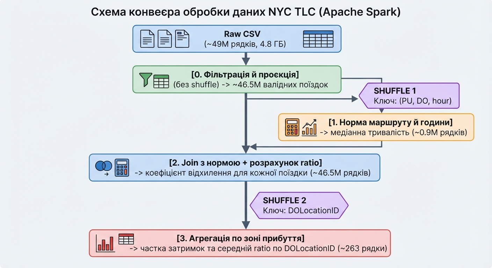
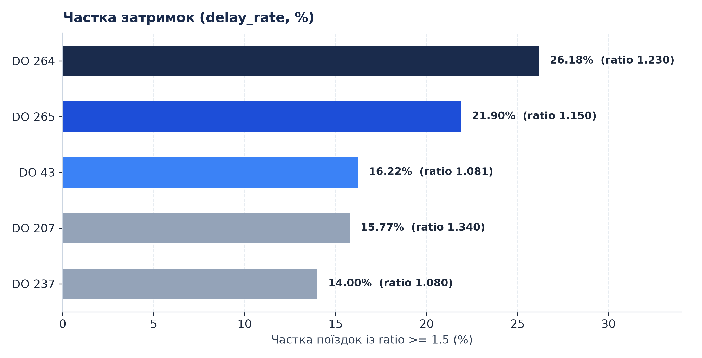

# Аномалії тривалості поїздок NYC TLC відносно погодинної норми маршруту

Остапенко Дмитро, МП ІПЗ-1  

---

## Задача та дані

**Мета:** знайти зони `DOLocationID` із найбільшою часткою затримок (`ratio >= 1.5`) відносно медіани `(PU, DO, hour)`.

**Вхід:** `48 722 602` рядків (`~4.8 ГБ` CSV) -> `46 266 382` валідних поїздок (`-5.04%`).

---

## Схема етапів та ключі

- Етап 0: фільтр + проєкція (`pu_id, do_id, hour, dur_sec`).
- Shuffle 1 `(PU, DO, hour)`: медіана (`percentile_approx`) та `cnt >= 3`.
- `SortMergeJoin` + `ratio` (`is_delayed` при `>= 1.5`) -> Shuffle 2 `DOLocationID` (`259` зон).
- Перекіс по `DO`: топ-10 зон = `30.23%` поїздок (лідер `236`: `1.88 млн`, `4.05%`).

---

## Оцінка проти факту

| Метрика | Оцінка | Факт (Baseline) | Причина |
| :--- | :--- | :--- | :--- |
| Прочитано | ~4.8 ГБ (1 раз) | `23.72 GiB` | 2 скани CSV + `show(20)` і `write.csv` |
| Партиції | Базова оцінка | `16` (AQE) | Динамічне згортання AQE |
| Spill | — | `4.27 GiB` (`27`) | Стан `percentile_approx` + `2.2 GiB` BlockManager |

- Найважчі таски (Stages 6, 15): до `17.1 с` та `14.8 с`, spill до `216.1 MiB`.

---

## Експеримент: `.persist(MEMORY_AND_DISK)`

- Зміна: кеш очищеного `trips_df` перед медіаною та `join`.
- Гіпотеза: час `-20..35%` (`110–135 с`), читання CSV удвічі менше.

| Варіант (медіана 3 запусків) | Час (с) | Прочитано | Shuffle | Spill |
| :--- | :--- | :--- | :--- | :--- |
| Baseline | `181.1` | `23.72 GiB` | `1.77 GiB` | `4.27 GiB` (`27`) |
| `.persist(MEMORY_AND_DISK)` | `133.6` (`-26.2%`) | `10.87 GiB` (`-54.2%`) | `1.77 GiB` | `4.77 GiB` (`50`) |

- Читання і час впали; spill зріс через менший Execution pool у `2.2 GiB`.

---

## Результати по зонах (`DOLocationID`)

| `DO_ID` | Поїздок | `delay_rate` | `avg_ratio` |
| :--- | :--- | :--- | :--- |
| **264** | `89 963` | **26.18%** | `1.230` |
| **265** | `198 394` | **21.90%** | `1.150` |
| **43** | `452 336` | **16.22%** | `1.081` |
| **207** | `647` | **15.77%** | `1.340` |
| **237** | `1 859 788` | **14.00%** | `1.080` |

---

<h1 class="final">Демонстрація та питання</h1>
